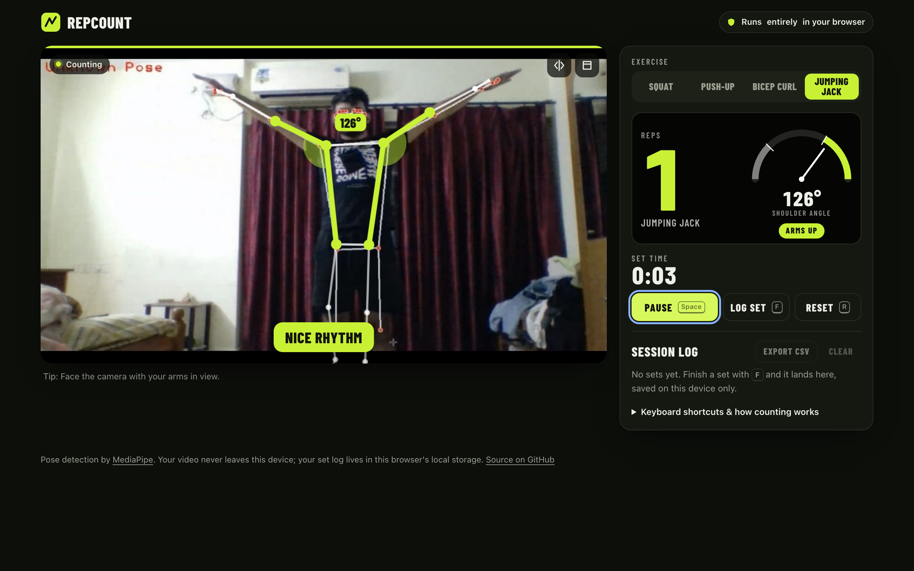
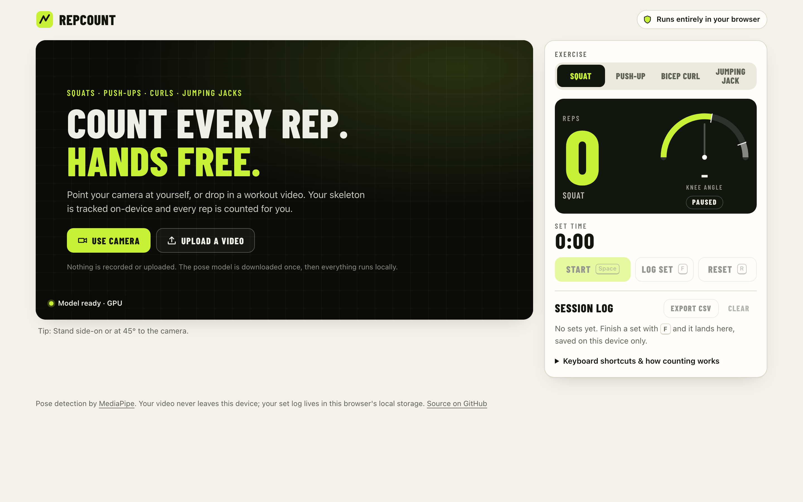
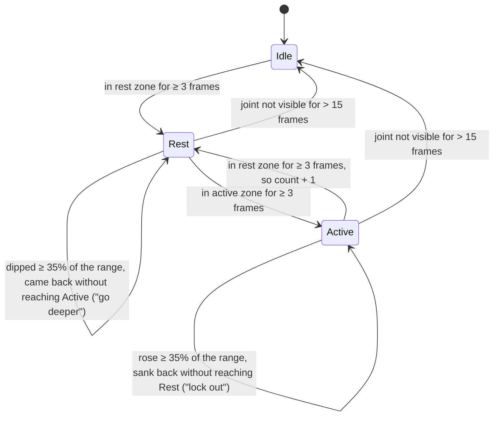

# RepCount

**A workout rep counter that runs entirely in your browser.** Point your webcam at yourself (or drop in a workout video) and RepCount tracks your skeleton with MediaPipe, measures the working joint angle, and counts squats, push-ups, bicep curls and jumping jacks. There's no server and nothing to upload, and the video never leaves your device.

**Live demo (planned URL):** https://samarthjaiswal.github.io/repcount/

[](https://github.com/SAMARTHJAISWAL/repcount/actions/workflows/ci.yml)



<details>
<summary>Idle screen (light theme)</summary>



</details>

## Features

- **Four exercises:** squat (knee angle), push-up (elbow angle), bicep curl (elbow angle, per arm: left, right, or both counted separately) and jumping jack (shoulder angle, both arms).
- **Webcam or video file.** Upload or drag in a video to try it without a camera. The webcam preview is mirrored by default (toggle with <kbd>M</kbd>).
- **Robust counting:** a per-exercise state machine with a hysteresis dead band, frame-rate-independent exponential smoothing, minimum dwell frames, visibility gating, and automatic choice of the better-seen side of the body.
- **Form cues that are actually measured:** "Go deeper", "Lock out at the top", "Curl all the way up", "Keep a straight line from shoulders to ankles", "Keep your elbow pinned to your side". Each one comes from a joint angle crossing (or failing to cross) a threshold. Nothing is guessed.
- **Live feedback:** skeleton overlay faded by landmark confidence, the measured joint highlighted with its angle, a 0–180° gauge showing the rest and active zones, the phase, and a set timer.
- **Session log:** sets × reps × exercise × duration, saved in `localStorage` (every access guarded, so it degrades gracefully in private mode) with **CSV export**. The export is protected against spreadsheet formula injection.
- **Accessible and responsive:** keyboard shortcuts, visible focus, a screen-reader live region for reps and cues, light/dark themes from `prefers-color-scheme`, reduced-motion support, and a layout that works on a phone.

| Key | Action |
| --- | --- |
| <kbd>Space</kbd> | Start / pause |
| <kbd>F</kbd> | Log the set |
| <kbd>R</kbd> | Reset the set |
| <kbd>1</kbd>–<kbd>4</kbd> | Pick exercise |
| <kbd>M</kbd> | Mirror preview |

## How counting works

### 1. Joint angles

MediaPipe's PoseLandmarker returns 33 landmarks per frame. For each exercise, RepCount takes three of them and computes the **interior angle** at the middle one, between 0° (fully folded) and 180° (straight), using `atan2(|cross|, dot)`. This is the same approach as my Python project [RealTimePoseDetection](https://github.com/SAMARTHJAISWAL/RealTimePoseDetection).

MediaPipe normalises x by frame width and y by frame height, so the points are converted back to pixels before any angle is measured. Skip that step and a true 90° elbow tilted on a 16:9 frame reads as something else (there's a test for this).

### 2. Thresholds

| Exercise | Angle measured at | Points | Rest (start/end) | Active (far end) | Side |
| --- | --- | --- | --- | --- | --- |
| Squat | knee | hip → knee → ankle | ≥ 160° | ≤ 100° | better-visible side |
| Push-up | elbow | shoulder → elbow → wrist | ≥ 155° | ≤ 95° | better-visible side |
| Bicep curl | elbow | shoulder → elbow → wrist | ≥ 150° | ≤ 55° | each arm independently |
| Jumping jack | shoulder | hip → shoulder → elbow | ≤ 45° | ≥ 120° | mean of both arms |

The gap between the two thresholds is a **dead band**. An angle inside it never changes state, so hovering around either line can't produce double counts.

### 3. The state machine



- **A rep is counted on the return** (rest → active → rest), so it is only complete once you're back at the start.
- **Idle first:** nothing counts until the start position has been seen. Standing up from the bottom when tracking begins is not a rep.
- **Dwell:** a zone must hold for 3 consecutive frames before the phase changes, which rejects one- and two-frame detection spikes.
- **Smoothing:** angles pass through an exponential moving average with a 65 ms time constant (α ≈ 0.4 at 30 fps). The weight comes from the actual frame interval, so a slow phone at 8–10 fps doesn't lag behind the movement.
- **Visibility gating:** every landmark of the joint needs a MediaPipe visibility of at least 0.5 and must lie inside the frame. Otherwise that frame is a gap, counting pauses, and the app says *"Step back so your whole body is in view"*. Short gaps (≤ 15 frames) are bridged. Longer gaps abandon the rep in progress, because the app can't vouch for what happened during them.
- **Side choice:** side-on exercises use whichever side the camera sees better, and only switch when the other side is better by a margin (0.15), so the reading doesn't flip mid-rep.
- **Partial reps never count.** They only produce a cue.

All of this lives in [`src/core/`](src/core) as plain TypeScript with no DOM or MediaPipe imports (ESLint enforces that), which is what makes it unit-testable.

## Privacy

- Pose detection runs **on your device** (WebAssembly + WebGL via MediaPipe Tasks). Video frames are never sent anywhere. An uploaded video is opened as a local `blob:` URL.
- The only network requests are static downloads: the app itself, the MediaPipe WASM runtime from jsDelivr (pinned to the exact npm version), and the `pose_landmarker_lite` model from Google's model storage. Those hosts see an ordinary file request, never any image data.
- The set log is stored only in your browser's `localStorage`. There are no accounts, analytics or cookies.

## Run it locally

Requires Node 22.12+ (see `.nvmrc`).

```bash
npm ci
npm run dev        # http://localhost:5173/
npm run build      # typecheck + production build into dist/
npm run preview    # serve dist/ at http://localhost:4173/
```

Webcam access needs a secure context: `localhost` qualifies, but a LAN IP over plain HTTP does not.

## Deploy

- **Vercel:** import the repo at [vercel.com/new](https://vercel.com/new). The Vite preset is detected and `vercel.json` adds security and caching headers. Every push to `main` redeploys.
- **GitHub Pages mirror:** `.github/workflows/deploy.yml` builds with `GITHUB_PAGES=true`, which sets the Vite base to `/repcount/`, and publishes to https://samarthjaiswal.github.io/repcount/.

## Tests

```bash
npm test           # Vitest, 73 tests
npm run coverage   # coverage for src/core
npm run typecheck  # tsc --noEmit
npm run lint       # ESLint (typescript-eslint)
npm run check      # all of the above + build
```

The tests drive the pure core with **synthetic angle sequences and synthetic landmarks**: clean reps, partial reps that must not count, bouncing at the bottom, hovering on both thresholds, one- and two-frame spikes, short and long visibility dropouts, uniform jitter with outlier frames, landmarks extrapolated off-screen, per-arm curls with one arm hidden, sustained versus momentary posture faults, frame-rate independence at 8 fps, 16:9 aspect handling, CSV escaping and formula injection, corrupt or hostile `localStorage`, and a guard that the CDN WASM version matches the npm package. Coverage of `src/core` is about 98% of statements.

CI (`.github/workflows/ci.yml`) runs typecheck, lint, tests and build on every push and pull request. `deploy.yml` builds and publishes `dist/` to GitHub Pages on every push to `main`.

## Project structure

```
src/
  core/                 pure logic: no DOM, no MediaPipe (unit-tested)
    geometry.ts         interior joint angle, pixel-space conversion
    smoothing.ts        EMA with frame-interval-derived weight
    landmarks.ts        BlazePose indices, visibility rules
    repCounter.ts       the rest/active state machine
    exercises.ts        per-exercise joints, thresholds, cues, posture rules
    tracker.ts          per-frame pipeline: gating → side → angle → smoothing → counter → cues
    feedback.ts         event cues and sustained posture checks
    session.ts          set log persistence, CSV export, totals
    csv.ts              RFC 4180 writer with formula-injection guard
    format.ts, stopwatch.ts
  app/
    pose.ts             MediaPipe PoseLandmarker wrapper (GPU, CPU fallback)
    overlay.ts          canvas skeleton + highlighted joint
    gauge.ts            SVG angle gauge
  main.ts               UI wiring, sources, frame loop, keyboard, log
  styles.css
tests/                  Vitest suites + synthetic pose builder
.github/workflows/      CI and Pages deploy
```

## Limitations

- **2D angles.** Angles are measured in the image plane, so they depend on camera placement. Squats and push-ups read best side-on (a squat filmed straight on barely changes the projected knee angle), and jumping jacks read best facing the camera. Each exercise shows a camera tip.
- **Thresholds are fixed**, chosen for typical range of motion rather than calibrated per person. Very deep or very shallow movers may need different numbers.
- **Jumping jacks are counted from the arms only.** Leg spread is not checked.
- **Form cues are deliberately few.** Only faults visible in a joint angle are flagged. There's no knee-valgus, bar-path or tempo analysis.
- **One person at a time** (`numPoses: 1`), using the lite model for fast loading. Dwell and gap limits are counted in frames, so their duration in seconds varies with the frame rate.
- **Not fully offline yet:** the model and WASM are fetched from CDNs on first load (no service worker).
- **Verification:** counting logic is covered by unit tests, and the full browser pipeline (model load, overlay, angles, counting jumping jacks from real detections, set log, CSV) was checked headlessly against a video built from still photos. Live webcam counting hasn't been exercised by automated tests.

## Credits

- Pose estimation: [MediaPipe Pose Landmarker](https://ai.google.dev/edge/mediapipe/solutions/vision/pose_landmarker) (`@mediapipe/tasks-vision`, Apache 2.0) by Google.
- Display type: [Barlow Condensed](https://fonts.google.com/specimen/Barlow+Condensed) (SIL OFL), self-hosted via Fontsource.
- Screenshot photos: the author, from [RealTimePoseDetection](https://github.com/SAMARTHJAISWAL/RealTimePoseDetection). Those images already carry that project's own skeleton drawing, under RepCount's overlay.

## License

[MIT](LICENSE) © 2026 Samarth Jaiswal
